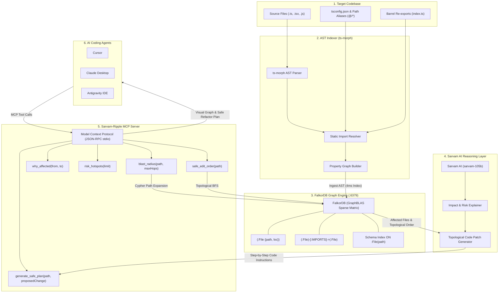

<div align="center">
  <h1>🌊 Sarvam-Ripple</h1>
  <p><strong>FalkorDB-Powered Dependency Graph & Sarvam AI Architectural Guardian for AI Coding Agents</strong></p>
  <p>
    <a href="https://github.com/shriharidesai209-commits/Sarvam-Ripple"><strong>GitHub Repository</strong></a> &bull;
    <a href="https://www.falkordb.com/"><strong>FalkorDB</strong></a> &bull;
    <a href="https://www.sarvam.ai/"><strong>Sarvam AI</strong></a> &bull;
    <a href="https://modelcontextprotocol.io/"><strong>Model Context Protocol</strong></a>
  </p>
</div>

---

## 🚨 The Problem: AI Coding Agents Break Code in the Dark
When AI coding agents (Claude, Cursor, Copilot, Antigravity) edit or refactor code in large repositories, they operate with dangerous **tunnel vision**. A single change to an exported function, interface, or shared utility silently breaks downstream consumers 2, 3, or 4 hops away.

Plain text search and grep cannot solve this:
- **Barrel re-exports** (`export * from './...'`) mask true dependency chains.
- **Path aliases** (`@/components`, `~/utils`) confuse directory search.
- **Common identifier names** (`id`, `user`, `status`) return hundreds of false-positive grep matches.
- **No topological ordering**: AI assistants don't know which order to edit files to avoid cascading build breakages.

---

## ⚡ The Solution: Sarvam-Ripple
**Sarvam-Ripple** is a high-performance Model Context Protocol (MCP) server that pairs **FalkorDB's** sub-5ms graph traversals with **Sarvam AI's** deep architectural reasoning:

1. **Deterministic Dependency Graph (FalkorDB)**: Ingests repository AST into a connected property graph of `(:File)` nodes and `[:IMPORTS]` edges with resolved path aliases and barrel files.
2. **Instant Visual Blast Radius**: Computes multi-hop blast radiuses in 3–5ms and renders an in-chat color-coded Mermaid graph.
3. **Architectural Safe Plan (Sarvam AI)**: Sarvam AI analyzes the affected files in topological sequence and writes an exact step-by-step code modification plan.
4. **Autonomous Zero-Regression Execution**: The AI coding agent applies the changes file-by-file without breaking builds or tests.

---

## 🏗️ System Architecture



---

## 🛠️ The MCP Tools

| Tool | Purpose | What It Returns |
| :--- | :--- | :--- |
| **`generate_safe_plan(path, proposedChange)`** | **Primary Tool** called before editing any code | Visual Mermaid blast radius graph + Sarvam AI step-by-step topological refactor instructions |
| **`blast_radius(path, maxHops=4)`** | Evaluates transitive damage of a change | Total dependent count, files grouped by distance, and in-chat visual diagram |
| **`why_affected(from, to)`** | Traces dependency chains | The exact shortest import chain between any two distant files |
| **`risk_hotspots(limit=10)`** | Identifies architectural bottlenecks | Highest in-degree files with the most incoming dependents |
| **`safe_edit_order(path)`** | Previews edit sequence | Files ordered topologically by distance from target (0 to N) |

---

## 🚀 Quickstart Guide (3 Minutes)

### 1. Start FalkorDB
```bash
docker run -d --name falkordb -p 6379:6379 -p 3000:3000 falkordb/falkordb:latest
```
- **Graph Database**: `localhost:6379`
- **Interactive Visual Studio**: `http://localhost:3000` (select graph `ripple` to explore nodes visually)

### 2. Clone and Build
```bash
git clone https://github.com/shriharidesai209-commits/Sarvam-Ripple.git
cd Sarvam-Ripple
npm install
npm run build
```

### 3. Configure Environment
Copy `.env.example` to `.env`:
```bash
cp .env.example .env
```
```env
SARVAM_API_KEY=your_key_here
SARVAM_MOCK=false
FALKOR_HOST=localhost
FALKOR_PORT=6379
FALKOR_GRAPH=ripple
```
*(Tip: Set `SARVAM_MOCK=true` during development to save API credits. Switch to `false` for live demos and production).*

### 4. Index Your Repository
```bash
node dist/cli.js index /path/to/your/project
```

### 5. Connect to Your AI Editor (MCP Config)
Add to your `claude_desktop_config.json`, Cursor MCP settings, or Antigravity IDE:
```json
{
  "mcpServers": {
    "sarvam-ripple": {
      "command": "node",
      "args": ["/absolute/path/to/Sarvam-Ripple/dist/server.js"],
      "env": {
        "SARVAM_API_KEY": "your_sarvam_api_key",
        "SARVAM_MOCK": "false"
      }
    }
  }
}
```

---

## 💻 CLI Commands (Developer Inspection)

```bash
# Generate complete Sarvam AI safe plan + visual graph
node dist/cli.js plan src/types/api.ts -c "Rename field id to userId"

# Calculate blast radius
node dist/cli.js query blast_radius src/types/api.ts

# Explain why file A affects file B
node dist/cli.js query why_affected src/main.tsx src/utils/cn.ts

# Find architectural risk hotspots
node dist/cli.js query risk_hotspots

# View topological edit order
node dist/cli.js query safe_edit_order src/components/button.tsx
```

---

## 👥 Built By
- **Trivikram Kalagi**
- **Shrihari Desai**
- **Vinayak Pattar**
- **Anand Sirigiri**

Licensed under [MIT](LICENSE).
